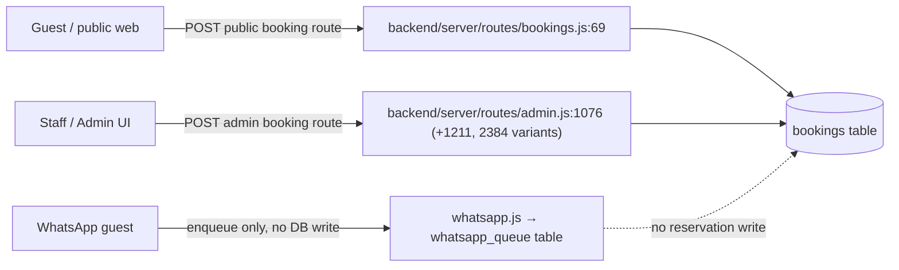
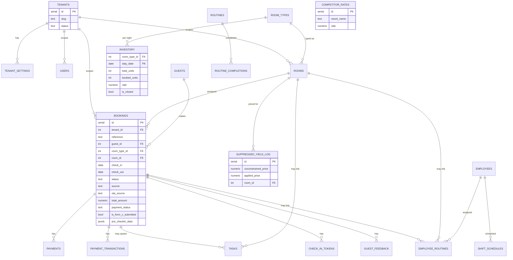

# Sunshine — Verified Gap Matrix & Hardening Profile

Produced by a read-only code audit (not from the external gap report, which analysed an older zip). Every CONFIRM below is resolved from actual files; every gap item is evidence-backed.

## 0. Inventory (CONFIRMED)

- **Language:** Plain JavaScript, no TypeScript (no `tsconfig.json`, no `.ts` files).
- **Query layer:** Raw `pg` (node-postgres) via `backend/server/config/db.js` — `adminPool` (platform/cross-tenant) + `forTenant(tenantId)` (per-tenant scoped pool/query wrapper). No Knex/Prisma.
- **Migrations:** Hand-written idempotent scripts — `backend/db/schema.sql` (base DDL, `IF NOT EXISTS`/`ADD COLUMN IF NOT EXISTS`), `backend/db/migrate.js` (adds operational tables/columns), `backend/db/migrate-tenancy.js` (adds `tenant_id` to every table, enables Postgres RLS, creates non-superuser app role). No Knex/Umzug/Prisma Migrate.
- **Job scheduler:** `node-cron`, in-process, scheduled from `backend/server/server.js` (e.g. `autoCheckoutExpired` daily, `rateShop` twice daily). No pg-boss, no Redis, no OS crontab — already matches the "no Redis / schedules live in the app" target, just needs a durable-queue upgrade (pg-boss) for retry/outbox semantics.
- **Auth:** JWT (`jsonwebtoken`) + `bcryptjs`. **NOT** a single hardcoded admin — real `users`/`employees` tables with a `role` column (`owner | manager | staff`), tokens carry `tenant_id` + role, `requireAuth` cross-checks token `tenant_id` against the host-resolved tenant, `requireAdmin`/`requireOwner` gate by role. Coarse (3 roles, blanket gates) but genuinely multi-user, not a stub.
- **WhatsApp:** `@whiskeysockets/baileys` in `backend/server/services/whatsapp.js` (300 lines) + `backend/.baileys_auth/` session store. It only enqueues outbound messages to a `whatsapp_queue` table — it does **not** itself insert reservations.
- **Tenancy:** Real, not aspirational. Column is named `tenant_id` (not `property_id` as the profile assumed) but is functionally identical: added to every table by `migrate-tenancy.js`, FK'd to `tenants(id)`, NOT NULL + indexed per table (two tables — `notification_logs`, `whatsapp_queue` — left nullable, fail-closed under RLS), Postgres RLS enabled with a `tenant_isolation` policy per table, and a non-superuser DB role created so RLS can't be bypassed. `middleware/tenant.js` resolves tenant from subdomain/header and attaches `req.db = forTenant(id)`; `middleware/auth.js` additionally requires the JWT's `tenant_id` to match. **Deviation to flag, not silently rename:** decide whether to rename `tenant_id`→`property_id` repo-wide for profile consistency, or update the profile to say `tenant_id`.
- **Tests:** `playwright` is a devDependency (e2e capable) but no test files found (no `*.test.js`, `*.spec.js`, `/tests/`, `/e2e/` directories). No unit test framework (no jest/vitest). Effectively **no automated test coverage today.**
- **Frontend libs:** React 18 + Vite 5, `lucide-react` (icons), `socket.io-client`. **No grid lib, no chart lib, no DnD lib, no i18n lib** — Calendar/tape-chart and dashboard metrics are hand-rolled divs/CSS, not a grid component; "Reuse existing components before adding libraries" is currently easy to honor because there's little to reuse for grid/chart/DnD — these will likely need a first-time dependency add (profile says "ask before adding any dependency" — flag this explicitly when PricingHub/Dashboard work starts).

## 1. Reservation write paths (CURRENT — violates "ONE booking path")

Two independent runtime paths both do `INSERT INTO bookings` with separately re-implemented availability/stop-sell checks:

**Finding:** `bookings.js` and `admin.js` each duplicate the `inventory.is_closed` / `booked_units >= total_units` sold-out check independently (`bookings.js:32-44` vs `admin.js:1025-1030`, `1211-1215`, `2384-2392`). This is the single highest-priority refactor target for the V2 modular-monolith move: both must be collapsed into one `ReservationService` (application layer) before any OTA-inbound or WhatsApp-direct-write path is added, per Standard Narrowing's "ONE booking path" rule.

## 2. Schema (current, consolidated from schema.sql + migrate.js + migrate-tenancy.js)

Every pre-existing table additionally carries `tenant_id` (nullable only on `notification_logs`, `whatsapp_queue`) with RLS enabled — omitted above for readability. No `audit_log` table exists anywhere.

## 3. Gap matrix (22 items, verified)

| # | Capability | Verdict | Evidence / what's missing |
|---|---|---|---|
| 1.1 | OTA 2-way sync | **MISSING** | `ota_source`/`ota_ref` are free-text labels set manually by staff (`admin.js:2332`, `calendar.js`). No channel-manager API push/pull exists. |
| 1.2 | Rate/meal plans | **MISSING** | No `meal_plan`/`rate_plan` table or column anywhere; one flat `rate` per room type per night. |
| 1.3 | Restrictions/stop-sell | **PARTIAL** | `inventory.is_closed` exists and is enforced (`admin.js:963-1030`, `bookings.js:32-44`, `availability.js:23`) — but it's a single open/closed flag only. No min/max-stay, no CTA/CTD. |
| 1.4 | iCal | **MISSING** | Zero `.ics`/VCALENDAR references in the codebase. |
| 2.1 | Dynamic pricing | **PARTIAL** | `PricingHub.jsx` + `suppressed_yield_log` capture manager price overrides (`admin.js:2592-2620`) — an audit log of manual decisions, not an automated demand-based engine. |
| 2.2 | Parity/comp-shop | **MISSING (mocked)** | `rateShop.js` explicitly stubs `fetchCompetitorRates()` with `Math.random()` against 3 hardcoded fake competitor names; comment says "swap with a real OTA Insight API call." Runs on a real cron (`server.js:165`) into a real table, but the data is fabricated. |
| 2.3 | Yield rules | **MISSING** | No occupancy-threshold rules engine; only the manual-override log from 2.1. |
| 3.1 | Tape chart | **EXISTS** | `client/src/admin/Calendar.jsx` — genuine room×date grid with OTA color badges, scroll sync. |
| 3.2 | Folio/split billing | **MISSING** | `payment_transactions` is a per-booking transaction ledger, not a multi-payer split or per-guest folio. One booking = one balance. |
| 3.3 | GST invoicing | **EXISTS** | `notify.js:151-309` `buildInvoicePdf()` (pdfkit) renders real GST-compliant invoices with `gst_rate`/`gst_amount`; also triggerable from `admin.js:466`. |
| 3.4 | KYC/C-Form | **PARTIAL** | `kyc_type`/`kyc_number` captured, searchable, masked on invoices (`admin.js:829-846`, `1289-1340`, `483`). `is_form_c_submitted` is a boolean flag only (`calendar.js:76,137`) — no C-Form document generation or filing/export. |
| 4.1 | Room status | **PARTIAL** | `rooms.status` is only `available \| maintenance \| unavailable` (`admin.js:689`); no dirty/clean/inspected HK state machine — HK completion just flips back to `available` (`admin.js:423`). |
| 4.2 | Mobile HK | **MISSING** | No HK-specific UI; `Tasks.jsx`/`Routines.jsx`/`MyTasks.jsx` are general-purpose, not housekeeping-tailored. |
| 4.3 | Inventory/assets/work orders | **MISSING** | Zero hits for equipment/asset/work-order anywhere in backend. |
| 5.1 | Web booking engine + payments | **EXISTS** | `client/src/pages/Home.jsx` public booking page + `payments.js` real Razorpay integration (order creation, signature verification, refunds), tenant-scoped keys. |
| 5.2 | SMS/email fallback | **EXISTS** | `notify.js` has real nodemailer (9+ call sites) and real Twilio SMS send, both logged to `notification_logs`; genuinely wired alongside WhatsApp, not stubs. |
| 5.3 | Unified inbox | **MISSING** | No conversation/inbox UI component exists in `client/src`. |
| 6.1 | Night audit | **PARTIAL (misnamed)** | No "business date" concept at all — wall-clock date is used everywhere. The only daily job is `autoCheckoutExpired` (`server.js:146-162`, cron `0 0 * * *`), a cleanup sweep, not a folio-closing/business-date-advance night audit. |
| 6.2 | OTA reconciliation | **MISSING** | No payout/commission matching logic; `ota_source` is a label only (see 1.1). |
| 6.3 | KPIs | **EXISTS** | `Dashboard.jsx`, `OccupancyDonut.jsx`, `Operations.jsx`, `PricingHub.jsx` are real, wired reporting surfaces (RevPAR/ADR math not line-by-line verified, but not a stub). |
| 7.1 | RBAC | **PARTIAL** | Real but coarse: 3 roles (`owner`/`manager`/`staff`), two blanket gates (`requireAdmin`, `requireOwner`) in `middleware/auth.js:53-64`. No per-permission/action-level matrix. |
| 7.2 | Audit trail | **MISSING** | No `audit_log`/`activity_log` table anywhere. `notification_logs` (comms) and `operations_log` (HK task log) exist but neither is a generic who-changed-what-when trail. |

**Score vs. the external gap report:** of 22 items, the report's "missing" label holds for 11 (1.1, 1.2, 1.4, 2.2(real-data), 2.3, 3.2, 4.2, 4.3, 5.3, 6.2, 7.2), is downgraded to PARTIAL for 7 (1.3, 2.1, 3.4, 4.1, 6.1, 7.1, and 2.2's cron/table scaffolding which does exist even though the data is fake), and is simply wrong for 4 (3.1, 3.3, 5.1, 5.2, 6.3 — these exist and work). The report analysed a stale zip and significantly understated what's already built, especially tenancy/RBAC scaffolding and the guest-payment/notification stack.

## 4. Security red flags

1. **Hardcoded JWT secret fallback** — `backend/server/middleware/auth.js:2`: `process.env.JWT_SECRET || 'dev-secret'`. If unset in production, every token is signed with a publicly-known string. **Fix before any further hardening work.**
2. **SQL injection:** none found. All app-route queries are parameterized (`$1,$2…`). Only `migrate.js`/`migrate-tenancy.js` build SQL with interpolated identifiers, but against a fixed hardcoded table list, not user input — acceptable.
3. **Tenant-scoping leak:** none found in tenant-data routes — all go through `req.db` (`forTenant`). `platform.js` uses `adminPool` directly at ~10 sites, but that's the cross-tenant platform-admin surface by design, not a leak.
4. **PII in logs:** plaintext guest email/phone written via `console.log` in `notify.js` (lines 478, 544, 614, 682, 722, 833, 962, 1025, 1057) and `whatsapp.js` (236, 278, 286) — e.g. `` console.log(`[notify] Invoice sent → ${email}`) ``. Violates "No PII in logs" — needs masking before hardening sign-off.
5. No secrets found committed in the repo itself (checked `.env` is gitignored; `tenant_settings.razorpay_key_secret` is DB-stored, not hardcoded) — but confirm `.env` isn't accidentally tracked in git history before this becomes a public repo.

---

# Updated SUNSHINE PROFILE (all CONFIRMs resolved)

Sunshine Version: V1 → V2 ("PMS hardening")

Positioning: Owner-operated PMS for a 15-room boutique pool resort in White Town, Puducherry. WhatsApp-first guest channel + React admin panel for staff. Multi-tenant capable — one live property today, maybe a second later.

Runtime / language: Node.js + Express (service: sunshine-api). **CONFIRMED: plain JavaScript, no TypeScript.**

Framework: Express. DO NOT migrate to NestJS. Introduce module-per-domain folders as planned.

Architecture: Modular monolith, DDD-lite, Hexagonal ports for every external system.

Jobs/scheduler: **CONFIRMED: `node-cron`, in-process, scheduled from `server.js`** (e.g. nightly auto-checkout, twice-daily rate-shop). Upgrade to pg-boss for durable retry/outbox semantics as planned — no Redis, no OS crontab (Windows host).

Data: PostgreSQL, database `sunshine`. **CONFIRMED query layer: raw `pg`** via `adminPool` + `forTenant(tenantId)` — reuse this pattern; do not introduce Knex/Prisma.

Migrations: **CONFIRMED: hand-written idempotent SQL scripts** (`schema.sql`, `migrate.js`, `migrate-tenancy.js`), not a migration-tool framework. Continue the add→backfill→switch→drop discipline already partially followed (e.g. `tenant_id` rollout).

Tenancy: **CONFIRMED real and working** — column name is `tenant_id`, not `property_id`. Functionally equivalent: every table scoped, RLS enabled, non-superuser DB role, tenant resolved from session/host only (never request body). **Decision needed: keep `tenant_id` naming (update profile) or rename to `property_id` repo-wide (migration cost) — recommend keeping `tenant_id`, it's already correct and consistent.**

Identity: **CONFIRMED: NOT a single hardcoded admin.** Real JWT + bcrypt auth, `users`/`employees` tables, 3-role model (`owner`/`manager`/`staff`), tenant-pinned tokens. 7.1 scope is therefore "add per-permission granularity to an existing real system," not "build auth from scratch."

Frontend: React + Vite admin. Pages confirmed present: Dashboard, FrontDesk, PricingHub, Accounts (as DailyPayments/AddExpense), Staff, Tasks, Routines, Operations, plus Calendar, Guests, Bookings, CheckoutExtendPage, ShiftMaster, SpecialRequests, FeedbackAdmin. **No grid/chart/DnD/i18n library currently installed** — flag before PricingHub/Dashboard hardening work, since "reuse existing components" won't cover grid/chart needs; will need an explicit ask-before-adding-dependency conversation.

Deployment: Windows VPS, IIS reverse proxy, PM2, win-acme SSL — unchanged, not contradicted by anything found in code.

Integrations explored: eZee Centrix — **CONFIRMED not yet integrated**; `rateShop.js` is a mocked stand-in for competitor pricing, unrelated to Centrix. No channel-manager proxy code exists yet.

## Deltas from current (what V2 hardening actually has to do)

1. **Unify the two reservation write paths** (`bookings.js` + `admin.js`) into one `ReservationService` before adding any OTA-inbound or direct-WhatsApp-write path — currently violates "ONE booking path."
2. **Introduce the outbox pattern** — nothing today writes an outbox row in the same transaction as a state change; WhatsApp/SMS/email sends happen as direct side-effecting calls inside route handlers (`notify.js`), with no retry/backoff/idempotency-key/dead-letter mechanism. This is the biggest structural gap vs. the target architecture.
3. **Replace fabricated comp-shop data** (`rateShop.js`) with a real source or explicitly label it experimental/disabled until a real integration exists.
4. **Add an `audit_log` table and domain event** for admin-side mutations — currently zero audit trail.
5. **Mask PII in logs** (`notify.js`, `whatsapp.js`) — currently plaintext email/phone in `console.log`.
6. **Remove the `'dev-secret'` JWT fallback** or fail startup loudly if `JWT_SECRET` is unset in production.
7. **Introduce a true business-date / night-audit concept** — today only wall-clock date exists; `autoCheckoutExpired` is a cleanup cron, not a night audit.
8. **Add unit/integration tests** — none exist today beyond an unused Playwright devDependency; Standard Acceptance requires property-scoping tests, outbox tests, and a WhatsApp regression test that don't yet have any harness to run in.
9. **Decide and document `tenant_id` vs `property_id` naming** before writing new domain code that references either.
10. Real gaps confirmed as genuinely absent (build from scratch, not "harden"): OTA 2-way sync, meal plans, iCal, yield rules, split folio, mobile HK UI, assets/work orders, unified inbox, OTA reconciliation, C-Form filing flow, fine-grained RBAC.

---

## Progress log

### 7.1 Granular RBAC — implemented (2026-10-10)
- **Module:** `backend/server/modules/identity/{domain,application,infra,http}`. Domain (`permissions`, `lockout`, `approvals`, `delegation`) has no framework imports.
- **DB:** `db/migrate-rbac.js` (run by `db/migrate.js`, reversible via `node db/migrate-rbac.js down`): `permissions`, `roles`, `role_permissions`, `user_property_memberships`, `employee_devices`, `device_enrol_codes`, `approval_requests` (RLS on all tenant tables); lockout/token_version/pin columns on `users`/`employees`. `users.role` kept (display + rollback); memberships are authoritative.
- **Enforcement:** every route in admin/calendar/payments/iam carries `requirePermission(...)`; `test/route-coverage.test.js` fails any route without a marker. Permissions are read from the DB per request; `token_version` revokes sessions on role change / block / reset.
- **Removed:** seeded `admin/admin123`, `staff/staff123`, `'dev-secret'` JWT fallback (server refuses to start in production without `JWT_SECRET`). Owner is created with `npm run bootstrap-owner`.
- **Approvals:** refunds above threshold by non-approvers -> `approval_requests`; owner approves in *Access*; executor runs once (idempotent). `rate.override` policy exists but is wired when floors exist (1.2 / 2.x). Write-off: policy exists, route lands with 3.2.
- **Deferred / not done:** WhatsApp *inbound* admin commands and WhatsApp-reply approvals (no inbound handler exists in `whatsapp.js`; `resolveWhatsAppActor` is ready for it, lands with 5.2/5.3). Cross-property GROUP_MANAGER login (membership table supports it; one-tenant-per-host login does not yet). Cookies (kept Bearer header). Socket.IO does not re-check revocation.
- **Tests:** `backend/npm test` (node:test + supertest). Postgres suite is `test/rbac.pg.test.js` (needs `TEST_PG=1`).

**Deltas now closed:** #6 (JWT fallback), partially #8 (test harness exists).

